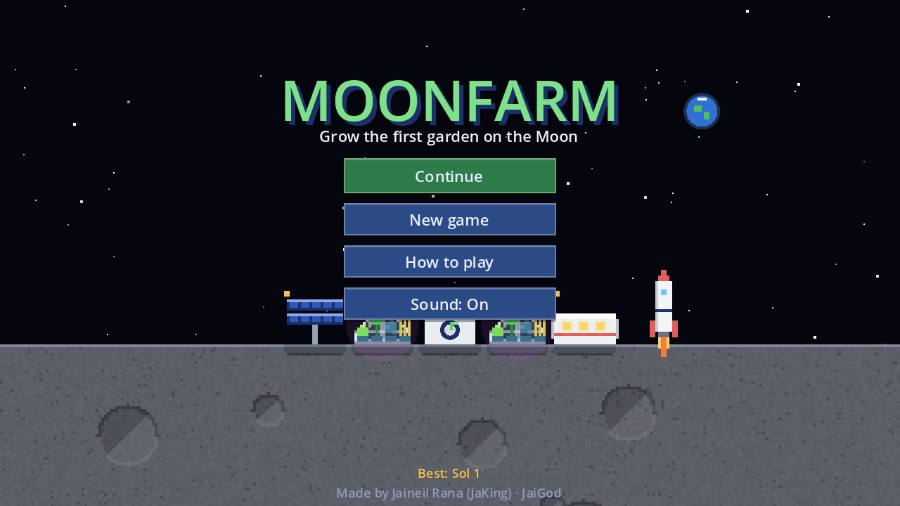
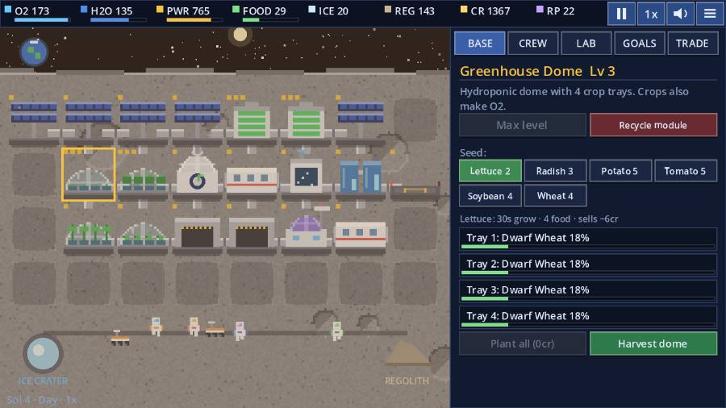
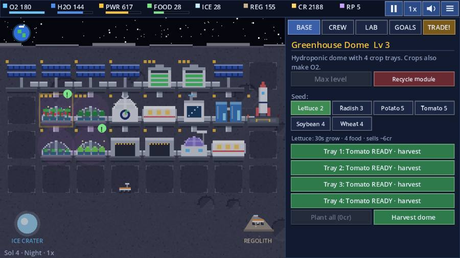
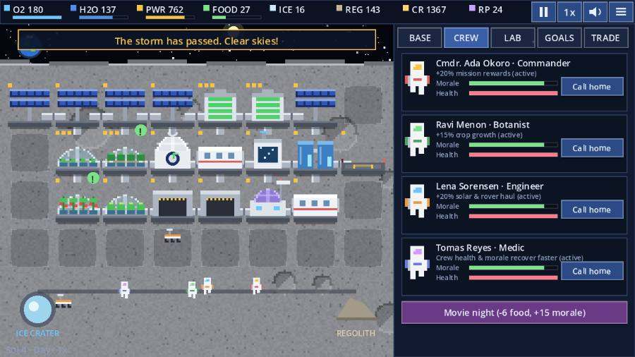
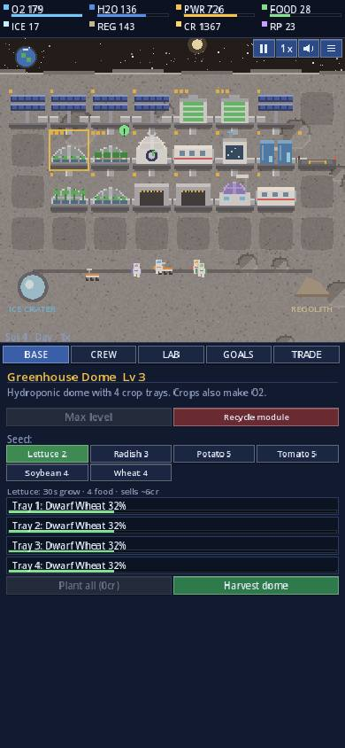

<div align="center">

# 🌙🥬 MOONFARM

### Grow the first garden on the Moon.

A pixel-art **farming + base-building sim** set on a lunar outpost, made in **Godot 4**.
Plant hydroponic crops, keep the oxygen flowing through the long lunar night, look after a crew of four, and throw the **First Lunar Harvest Festival**.

[](https://jaigod.github.io/moonfarm/play/)

[](https://jaigod.github.io/moonfarm/)
[](https://godotengine.org)
[](https://github.com/JaiGod/moonfarm/actions/workflows/pages.yml)
[](LICENSE)


</div>

---

## 📸 Screenshots

| Title screen | Day shift |
|:---:|:---:|
|  |  |
| **The lunar night** | **Crew & morale** |
|  |  |

<p align="center"><br><sub>Portrait layout on a 390px phone: map on top, controls at the bottom.</sub></p>

## ✨ Features

- 🥬 **Hydroponic farming:** 7 crops (lettuce, radish, potato, tomato, soybean, dwarf wheat, moonberry), each with its own grow time, food value and price. Growing plants also make oxygen.
- 🫁 **Real life support:** O2, water, power, food, ice and regolith all flow through the simulation. Electrolyzers turn water into air, recyclers reclaim water and melt ice, and solar only works while the Sun is up.
- 🌘 **Day/night cycle:** each sol has a day and a long, dark night. Build Battery Banks or the domes go dark and crops stop growing.
- 🏗️ **Base building:** 8 module types on an 8×4 grid (Greenhouse, Solar, Battery, Recycler, Electrolyzer, Quarters, Rover Bay, Lab), each upgradeable to level 3, plus recycling for refunds.
- 👩‍🚀 **A crew with moods:** Commander, Botanist, Engineer and Medic. Each has a perk that switches on at 75+ morale. Menu variety, quarters, movie nights and calls home keep them happy.
- 🚙 **Rovers & rockets:** send rovers to the ice crater or regolith field. Supply rockets land every sol with fluctuating prices, so you can sell crates and buy emergency water or O2.
- 🌪️ **Dust storms:** solar output crashes and rovers park until the storm passes.
- 🔬 **Research lab:** 8 projects, like LED tuning, new seed lines, drill bits and dust-shield panels.
- 📜 **10-mission story** from *First Sprouts* to the *Harvest Festival*, guided by Mission Control.
- 💾 **Autosave + Continue**, best-sol record, sound on/off, pause, 1×/2×/3× speed, win and lose screens.
- 🎨 **100% made in code:** every sprite is pixel art drawn procedurally by `art.gd`, and every sound is synthesized by `sfx.gd`. There are no image or audio files.

## 🎮 Controls

| Input | Action |
|---|---|
| **Mouse / touch** | Tap a tile to select it. Tap an empty tile to build, tap a dome to plant or harvest. Use the panel tabs: Base · Crew · Lab · Goals · Trade |
| `W A S D` / arrows | Move the tile cursor |
| `Enter` | Act on the selected tile |
| `Q` / `E` | Cycle options (module or seed) |
| `U` | Upgrade the selected module |
| `H` | Harvest everything that's ripe |
| `1`–`5` | Switch tabs |
| `Space` · `F` · `M` · `Esc` | Pause · speed 1×/2×/3× · sound · menu |

**How to win:** finish all 10 missions. **How to lose:** let the base run out of O2, or let crew morale sit near zero for too long.

## 🛠️ Tech stack

| | |
|---|---|
| Engine | [Godot 4.3](https://godotengine.org), GDScript, **Compatibility** renderer (WebGL 2) |
| Rendering | Immediate-mode `_draw()` for both the world and the UI, plus procedurally generated pixel-art textures |
| Audio | Runtime-synthesized `AudioStreamWAV` blips, chords and noise |
| Web export | Threads off (`variant/thread_support=false`), so it runs on GitHub Pages without COOP/COEP headers |
| CI/CD | GitHub Actions in the `barichello/godot-ci:4.3` container: smoke test, then Web export, then GitHub Pages |
| Saves | `user://` JSON (stored in IndexedDB on the web), loaded defensively |

## 📁 Project structure

```
moonfarm/
├── project.godot          # 640×360 canvas_items stretch, Compatibility renderer
├── main.tscn              # single scene → scripts/main.gd
├── export_presets.cfg     # "Web" preset (threads off)
├── scripts/
│   ├── sim.gd             # pure simulation: resources, crops, crew, rovers, rockets, missions, save/load
│   ├── main.gd            # screens, world rendering, input, particles, screen shake, demo mode
│   ├── panel.gd           # side/bottom panel UI (Base, Crew, Lab, Goals, Trade tabs)
│   ├── art.gd             # procedural pixel-art modules, astronauts, crops, rockets
│   └── sfx.gd             # synthesized sound effects
├── tests/smoke.gd         # headless bot plays the whole campaign + boots every screen
├── web/index.html         # landing page (served at /, game served at /play/)
├── docs/screenshots/      # README images
└── .github/workflows/pages.yml
```

Source links: [`scripts/`](scripts) · [`tests/`](tests) · [`web/`](web) · [`.github/workflows/`](.github/workflows)

## 🚀 Run locally

1. Install [Godot 4.3](https://godotengine.org/download) (standard build).
2. Clone the repo, open `project.godot` in Godot and press **F5**.
3. Run the headless smoke test:
   ```bash
   godot --headless --path . --import
   godot --headless --path . --script res://tests/smoke.gd   # prints "SMOKE OK"
   ```
4. Build the web version (needs the 4.3 export templates):
   ```bash
   mkdir -p build/play
   godot --headless --path . --export-release "Web" build/play/index.html
   cp web/index.html build/index.html
   cd build && python3 -m http.server 8000   # open http://localhost:8000
   ```

Tip: `play/#demo`, `play/#demo-night` and `play/#demo-crew` start a scripted, already-built base. That's how the screenshots above were taken.

## 📓 Development log

**Design goal:** make a cozy farming game with real stakes. On the Moon, crops aren't just money: they're food, morale and oxygen. Every system feeds another, so the player is always juggling.

- **Simulation first.** All the game logic lives in `sim.gd`, a `RefCounted` with no nodes. That made it trivial to save as JSON and, more importantly, to **test headless**: a bot plays the whole 10-mission campaign in CI on every push.
- **Compressed sols.** A real lunar day is about 29.5 Earth days. Here a sol is 180 seconds, with a 55% day and 45% night. The night is long enough that batteries matter, but short enough to stay fun.
- **Crops make air.** Growing trays add a little O2. This ties farming to survival, so an idle greenhouse is a real risk and not just lost income.
- **Morale drives perks.** Instead of a flat bonus, each astronaut's perk only switches on at 75+ morale. Menu variety (the galley remembers recent meals), quarters and movie nights all feed it, which makes "plant something different" a meaningful choice.
- **One UI, two layouts.** The whole UI is immediate-mode `_draw()` code with a layout table. Landscape puts the panel on the right. Portrait (phones) switches the content scale to 400×720 and moves the panel to the bottom, so it plays at 390px wide without any horizontal scroll.
- **Web-safe export.** I turned threads off and used the Compatibility renderer so the game runs on plain GitHub Pages hosting, which can't send the COOP/COEP headers that threaded Godot builds need.
- **Bug: the smoke-test bot starved.** My first CI bot sent rovers for ice whenever the ice stock was below 30. Recyclers melt ice right away, so that was *always* true. The bot never hauled regolith, couldn't afford a Research Lab, went broke on seeds and lost to low morale around sol 22. The fix was to send rovers for regolith once the ice mission is done and water is healthy. After that, the bot reaches the Harvest Festival on sol 8 without O2 ever dropping below 88.
- **Bug: screenshots showed "paused: no power".** Demo mode builds a big base so fast that the batteries start empty, and the first shot showed red warnings. Demo mode now starts with charged batteries.
- **Juice:** floating "+12 regolith" numbers, harvest particles, screen shake on storms, eased panel and toast animations, and astronauts wandering the walkway.

## 🌌 More JaiGod games

- 🌾 [Harvest Hollow](https://github.com/JaiGod/harvest-hollow), another farming game
- 🔌 [Circuit Siege](https://github.com/JaiGod/circuit-siege), a neon maze-building tower defense
- 🕯️ [The Hollow Between](https://github.com/JaiGod/the-hollow-between), a story RPG
- 🔥 [Isle of Embers](https://github.com/JaiGod/isle-of-embers)
- 👉 The full collection: **[github.com/JaiGod](https://github.com/JaiGod)**

---

<div align="center">

Made by Jaineil Rana (JaKing) · part of [JaiGod](https://github.com/JaiGod)

<sub>MIT License · original concept, art and audio, all generated in code</sub>

</div>
